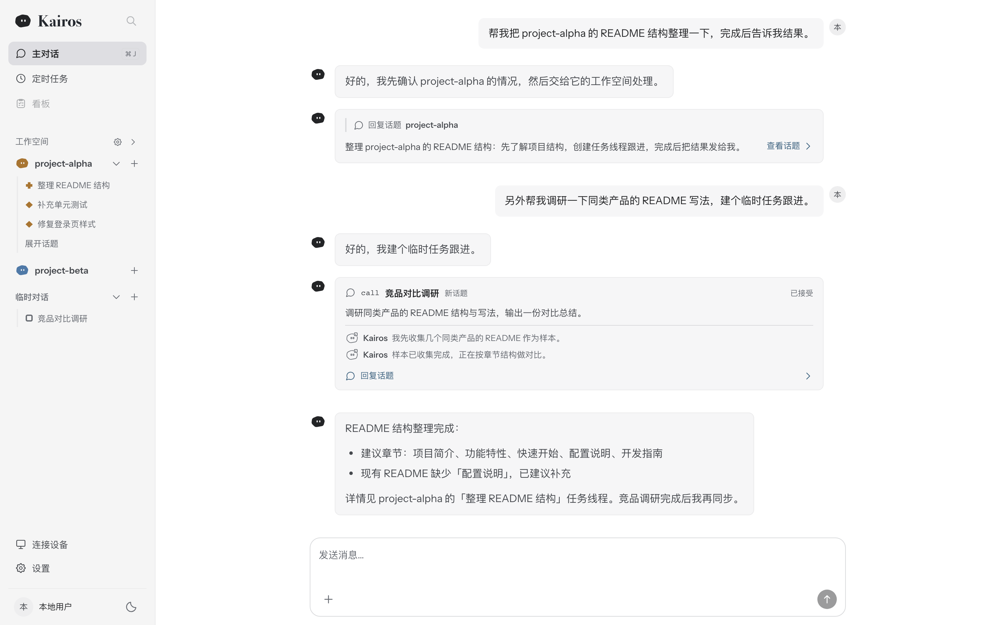
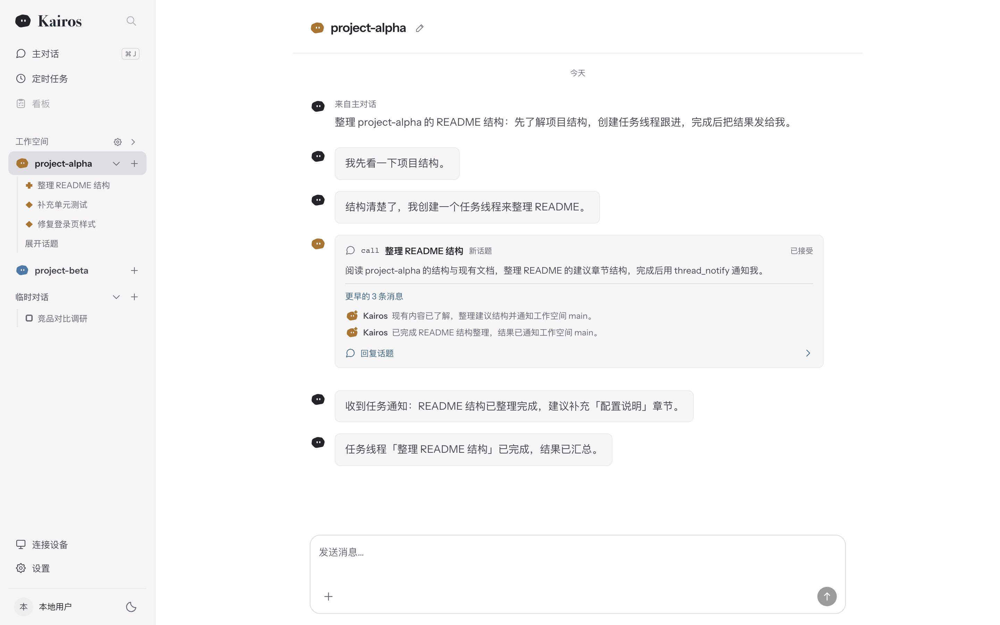
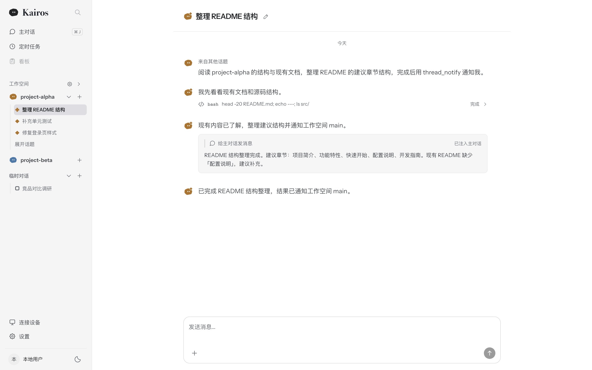
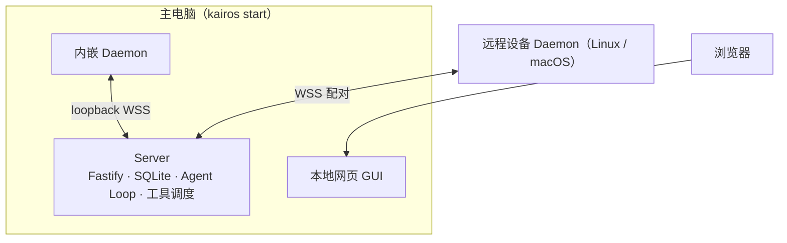
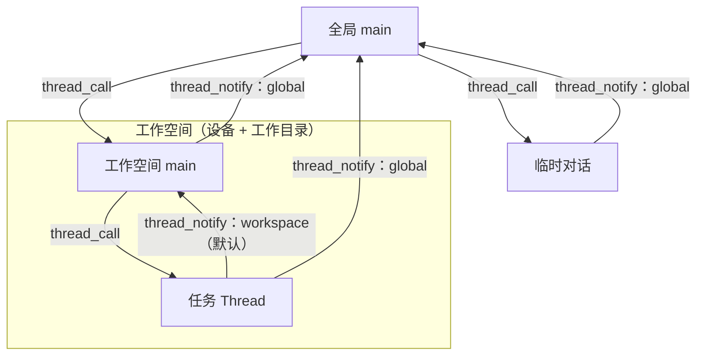

# open-kairos

[](LICENSE)
[](.node-version)
[](package.json)

open-kairos 是 Kairos 的单用户开源版本，一个本地优先的 AI Agent 工作台。在主电脑执行 `kairos start` 一条命令启动 Server、内嵌 Daemon 与本地网页；Agent 以本机为主环境工作，也可以连接其他 Linux/macOS 设备执行文件与命令操作。对话按工作空间组织，每个工作空间有自己的主对话。







## 功能特性

- **一条命令启动**：`kairos start` 拉起 Server 与内嵌 Daemon，自动完成主环境配对；本地网页与接口同端口托管，端口自动选择空闲端口。
- **主环境**：运行命令的本机内置注册为设备，不可删除，默认出现在设备列表，是全局 main 的工作环境；`AGENTS.md` 与 skills 资源固定从主环境根目录读取。
- **工作空间**：名称、一台设备和一个工作目录组成的持久记录，规定所属 Thread 的默认执行设备与路径；工作空间只提供默认值，不构成权限边界。
- **三级对话**：全局 main、工作空间 main、任务 Thread；话题按工作空间在界面聚类，每个工作空间固定展示其 main 对话；不属于任何工作空间的任务进入临时对话列表。
- **多设备**：其他 Linux/macOS 设备通过 Daemon 主动建立的 WSS 连接配对接入，与主环境使用同一套执行协议。
- **Agent 工具**：bash（可后台执行，大输出落盘主机日志文件，用 `read`/`grep` 继续读取）、`glob`/`grep` 文件搜索（Daemon 内置 ripgrep）、文件读写与编辑、`web_fetch`、`web_search`（SearXNG 或 Brave）、MCP 工具桥接（含 OAuth 授权）、Subagent 委派与结果交付。
- **上下文管理**：Context 完整保存逐条原始消息，Recap 按区间概述历史；输入超过模型上下文容量 80% 时自动硬切，也可用 `/compact` 手动硬切；`recall` 提供三张只读 SQL 查询表。
- **定时任务**：Automation 按 cron 触发，可指定工作空间，目标 Thread 自动创建。
- **单用户**：首次启动自动初始化唯一用户与租户，本地会话令牌认证，无需邮箱验证与 SMTP。

## 架构



Daemon 与 Server 之间只有一种协议：内嵌 Daemon 通过 loopback 连接，远程设备通过主动外连的 WSS 接入，配对、Operation 与输出回传完全一致。GUI 与 Server 之间使用 Connect RPC（Protobuf）。

对话层级与通知规则：



任务 Thread 只能通知本工作空间的 main 或全局 main；临时对话与工作空间 main 只能通知全局 main；全局 main 通过 `thread_call` 联系任何 Thread。

## 快速开始

### 环境要求

- Node.js 26.4 或更高版本（大版本 26，见 `.node-version`）
- pnpm 11.22 或更高版本（大版本 11，见 `package.json` 的 `packageManager`）

### 启动

```bash
pnpm install
pnpm build
pnpm start
```

`pnpm start` 即 `kairos start`。启动后终端打印访问地址：

```text
open-kairos 已启动：http://127.0.0.1:<端口>/#token=<本地会话令牌>
```

在浏览器打开该地址即进入本地网页。地址中的令牌用于首次登录，之后由会话 Cookie 保持；令牌同时保存在数据目录，丢失时重新查看启动输出即可。在可信网络中运行时可用 `KAIROS_AUTH_ENABLED=false` 关闭令牌认证，启动后打开地址直接进入。

### 配置模型

未配置模型时不能执行 Agent 任务。两种方式任选：

- **界面配置（推荐）**：打开网页的「设置 → 模型」，添加模型连接（接口地址、模型 ID、API key）。个人模型凭据加密保存在 Server。
- **环境变量**：启动前导出平台默认模型，支持 OpenAI Chat Completions、OpenAI Responses 与 Anthropic Messages 三种协议格式：

```bash
export KAIROS_MODEL_BASE_URL=https://model-provider.example.com/v1
export KAIROS_MODEL_ID=your-model-id
export KAIROS_MODEL_API_KEY=your-api-key   # 接口不要求认证时可省略
pnpm start
```

配置只从环境变量读取，不会自动加载 `.env` 文件。完整配置项见 [.env.example](.env.example)。

## 使用说明

### 主环境

主环境是运行 `kairos start` 的本机，首次启动自动注册并完成配对，不可删除、不可撤销，默认出现在设备列表，模型侧别名为 `main`。全局 main 与临时对话的默认执行位置是主环境根目录，默认为启动命令所在目录，用 `KAIROS_MAIN_WORKSPACE` 覆盖。

### 工作空间

在侧栏「工作空间」分组创建。工作空间由名称、一台设备（主环境或已配对设备）和该设备中的一个工作目录组成，`(设备, 路径)` 在租户内唯一。

- Thread 归属工作空间后，bash 等工具默认在该设备的工作目录执行。
- 工作空间只提供默认值：工具显式传入 `env_id` 时仍可操作任何已授权设备和任意路径。
- 创建工作空间时自动创建其工作空间 main 对话；没有消息的工作空间也在侧栏固定展示。
- 不属于任何工作空间的任务 Thread 进入临时对话列表，该列表没有 main 对话。

### 技能与 AGENTS.md

全部 Agent 的 `AGENTS.md` 与 `.agents/skills/<name>/SKILL.md` 资源快照固定从主环境 Daemon 用户的主目录读取：`AGENTS.md` 取自 `~/.kairos/AGENTS.md`，skills 取自 `~/.agents/skills/<name>/SKILL.md`，与主环境工作目录无关，也不随工作空间设备变化。主环境工作目录只决定全局 main 与临时对话的默认执行位置。Agent 用文件工具读取主环境的 skill 附属文件时需显式传 `env_id=main`。

### 连接其他设备

网页「连接设备」页生成一次性配对命令，在目标设备（Linux/macOS）上执行后，设备通过 WSS 主动接入。安装结束会打印 GUI 访问地址（与 Server 同源，使用 `kairos start` 打印的带令牌地址登录）和本机管理命令。配对安装包默认从 `dist/releases` 提供，用以下命令构建：

GUI 经反向代理暴露而设备与 Server 内网直连时，用 `KAIROS_DEVICE_ORIGIN` 指定配对命令中的设备直连地址（install.sh 下载与 WSS 接入），未设置时与 `KAIROS_PUBLIC_ORIGIN` 一致。`KAIROS_DEVICE_ORIGIN` 为不带回环主机的 `http://` 地址时，配对命令自动附加 `--allow-insecure-ws`：Daemon 默认只允许 `wss://` 或回环 `ws://` 连接，该开关显式允许可信内网中的明文 WS，配对时写入设备身份，后续服务启动沿用。

```bash
node scripts/build-daemon-release.mjs --version <版本> [--platform linux|darwin] [--arch x64|arm64]
```

设备上的 Daemon 通过系统服务常驻（Linux systemd 开机自启，macOS launchd 登录自启），日常管理命令：

```bash
kairos-daemon status   # 进程、WSS 连接与进行中操作
kairos-daemon stop     # 停止服务，保留配对身份
kairos-daemon start    # 重新启动
```

一台设备只绑定一个环境时省略参数即可；绑定多个环境（macOS）时可以追加环境 ID 或设备名（如 `kairos-daemon stop my-mac`），不带参数且终端可交互时会列出候选环境供选择。

### 定时任务

侧栏「定时任务」管理 Automation：按 cron 触发，触发时自动创建目标 Thread 并执行输入。定义可指定工作空间，未指定时落入临时对话列表。

## 配置

常用环境变量（完整列表与说明见 [.env.example](.env.example)）：

| 变量                                                                 | 作用                            | 默认值                         |
| -------------------------------------------------------------------- | ------------------------------- | ------------------------------ |
| `KAIROS_PORT`                                                        | 固定 GUI 端口                   | 自动选择空闲端口               |
| `KAIROS_DATA_DIR`                                                    | 数据目录                        | `~/.kairos/.data`              |
| `KAIROS_LOG_DIR`                                                     | Server 日志目录                 | `~/.kairos/log`                |
| `KAIROS_MAIN_WORKSPACE`                                              | 主环境工作目录                  | 启动命令所在目录               |
| `KAIROS_AUTH_SECRET`                                                 | 认证密钥（至少 32 字符）        | 自动生成并保存到数据目录       |
| `KAIROS_AUTH_ENABLED`                                                | 本地会话令牌认证开关            | `true`，`false` 时网页直接进入 |
| `KAIROS_MODEL_BASE_URL` / `KAIROS_MODEL_ID` / `KAIROS_MODEL_API_KEY` | 平台默认模型接口                | 未配置时不能执行 Agent 任务    |
| `KAIROS_PUBLIC_ORIGIN`                                               | 通过反向代理暴露时的公开 Origin | 接受回环与同源来源             |
| `KAIROS_DEVICE_ORIGIN`                                               | 配对命令中设备直连的 Origin     | `KAIROS_PUBLIC_ORIGIN`         |

## 数据与迁移

全部数据保存在 `<KAIROS_DATA_DIR>/kairos.sqlite`（SQLite），各命名空间以版本 1 安装最终结构。`node apps/server/dist/migrate.js --data-dir <dir> --backup-dir <dir>` 用于检查与迁移；当前版本只识别 v1 数据库，带旧版本或未版本化应用表的数据库明确拒绝，不提供 Kairos 旧数据的迁移。

## 开发

```bash
pnpm dev        # 开发模式：并行运行 Server 与 Vite 开发服务器
pnpm test       # 运行全部测试
pnpm check      # 完整门禁：依赖边界、文档、proto、lint、类型、测试、构建
```

默认测试使用测试 Provider、临时数据库和可控时间，不依赖真实 API key 或在线设备。修改 `.proto` 后执行 `pnpm proto:generate` 重新生成跨端代码。

设计文档见 [docs/README.md](docs/README.md)：

- [目标与范围](docs/goals-and-scope.md)
- [整体架构](docs/architecture.md)
- [数据定义与运行状态](docs/domain-and-state.md)
- [开发说明](docs/development.md)

## 许可证

[MIT](LICENSE)
